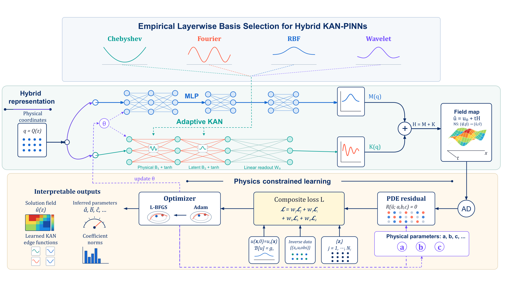
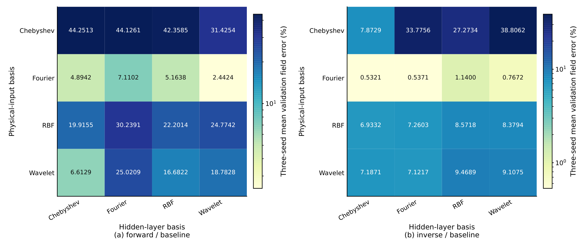
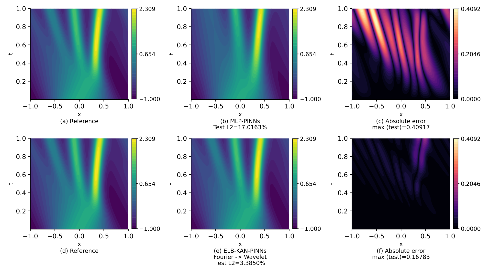

# ELB-KAN-PINNs

[](LICENSE)
[](requirements.txt)
[](requirements.txt)

This repository provides the source code and data for comparing layerwise basis choices in hybrid physics-informed neural networks for forward and inverse PDE problems. The experiments compare 16 ordered pairs of Chebyshev, Fourier, radial basis function and wavelet families in the KAN branch of a hybrid MLP–KAN model.

[Training code](src/training/) | [Evaluation code](src/evaluation/) | [Run-level results](data/test-errors.csv) | [Download the complete reproducibility package](https://github.com/Haoshaopeng/ELB-KAN-PINNs/releases/download/data-v1.0.0/ELB-KAN-PINNs.zip)



[Quick start](#quick-start) · [KdV results](#kdv-results) · [Source map](#source-map) · [Reproducing archived results](#reproducing-archived-results) · [Contributing](CONTRIBUTING.md)

## Quick start

Use Python 3.9 in a fresh environment. From the repository root:

```sh
python -m pip install -r requirements.txt
python examples/check_heat.py
```

The example uses the experimental heat-equation model with an RBF input layer and a Chebyshev hidden layer. It checks the initial condition, evaluates the PDE residual, and differentiates through the KAN readout on CPU. No dataset, checkpoint or GPU is required. This is an implementation check, not a reproduction of a trained model's accuracy.

## KdV results

**Choosing the basis pair.** Rows in the figure below give the basis applied to physical coordinates; columns give the hidden-layer basis. Each cell is a mean **validation** field error (%) across three seeds. On this benchmark, Fourier input with a wavelet hidden layer gives the lowest mean for the forward problem (left); Fourier input with a Chebyshev hidden layer gives the lowest mean for the inverse problem (right). This is an offline comparison using a reference solution, not an automatic rule for problems without reference data.



**Evaluating the frozen models.** The table reports relative errors (%) as mean ± standard deviation across the three seeds. Field errors are evaluated at independent test coordinates under the same physical conditions. The inverse pair was selected by validation **field** error, not by dispersion-coefficient error.

| KdV error (%) | MLP-PINNs | Same-family control (Fourier → Fourier) | Selected pair |
| --- | ---: | ---: | ---: |
| Forward field | 16.7126 ± 0.6803 | 7.0247 ± 0.5775 | 2.4160 ± 0.9184 |
| Inverse field | 9.2465 ± 0.8799 | 0.5350 ± 0.1300 | 0.5300 ± 0.0733 |
| Inverse dispersion coefficient | 1.6335 ± 0.3967 | 0.1437 ± 0.0175 | 0.0235 ± 0.0267 |

The figure below shows **one forward run (seed 42)**, not the three-seed average above. Each row displays the reference, prediction and absolute error on the same 25,600 test coordinates. The two error panels use a common color scale.



## Source map

| Path | Purpose |
| --- | --- |
| [Training and models](src/training/) | Hybrid and MLP models, PDE residuals, training schedules, seed lists and layer-pair experiments. |
| [Layer-pair experiments](src/training/layer_pairs.py) | Ordered-pair configurations and adapters for the underlying model factories. |
| [Additional PDEs](src/training/pde_benchmarks.py) | Model, residual and reference implementations used in the additional PDE cases. |
| [Evaluation](src/evaluation/) | Frozen-model evaluation, selection checks, periodic boundary checks and independent error calculations. |
| [KdV reference solver](src/references/) | Numerical reference and convergence checks. |
| [Audit entry point](run_verification.py) | Runs the verification sequence with the separate experiment archive. |

Training drivers use the Linux/CUDA environment and directory layout of the experiments. The checkpoint recovery scripts also depend on the original cluster scheduler. Neither is required for the CPU example or evaluation of saved models.

## Reproducing archived results

The release contains 1,752 final checkpoints. Evaluation of these checkpoints comprises 1,071 primary independent-test runs, 567 auxiliary independent-test runs and 114 supplementary cylinder-wake validation runs. The wake runs are not independent tests. The [dataset guide](DATASET.md) explains how to restore the external wake reference; the original third-party MAT file is not redistributed.

To reproduce the numerical results, obtain the matching experiment materials and extract them separately from the code. The bundle includes run records, model weights, training and reference data, a frozen test plan, and a comparison workbook. Keep its internal layout intact. From the repository root, replace `/path/to/materials` below with the **parent of the directory containing `runs.json`**:

```sh
python run_verification.py --materials-root "/path/to/materials" --device cpu
```

Use `--device cuda` for inference on a supported GPU. Logs, regenerated predictions, and the comparison report are written to a new directory under `verification_runs/`. Use `--run-dir` to choose another destination. A successful run ends with `ALL CHECKS PASSED`. This procedure evaluates stored model weights; it does not repeat training.

Keep the original names inside the experiment archive. The [source manifest](src/source_manifest.json) pairs each archived training filename and SHA-256 with the corresponding release module and its separate SHA-256. Verification checks both values; renamed sources are not treated as byte-identical to the archived versions.

## License

The experiment code is distributed under the [MIT License](LICENSE). The license does not grant rights to external datasets or third-party dependencies. See [CONTRIBUTING.md](CONTRIBUTING.md) for reporting issues or proposing changes.
